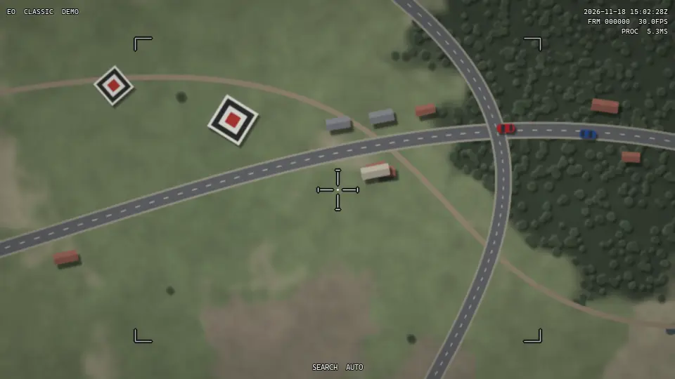
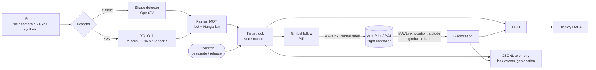
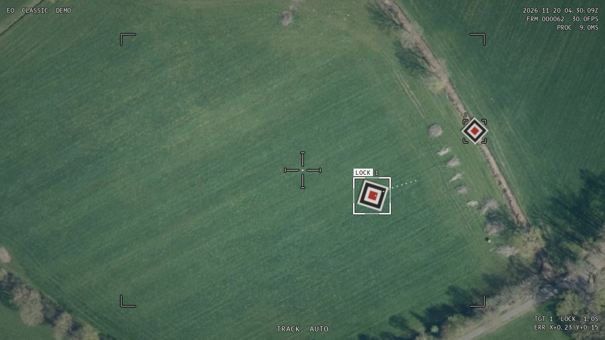
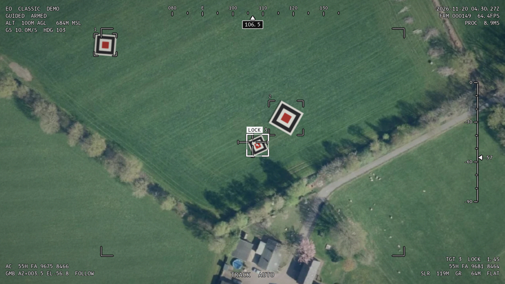

# SkyTrack — UAV Target Detection, Tracking & Target Lock

[](https://github.com/emir-mutlu/skytrack-uav-vision/actions/workflows/ci.yml)


[](https://huggingface.co/spaces/emir-mutlu/skytrack-uav-vision)

Real-time perception pipeline for UAV video: **detect → track → lock**, with an operator HUD,
structured telemetry and a reproducible benchmark. Talks **MAVLink** to ArduPilot / PX4 flight
controllers to geolocate targets and keep the locked target centred with the camera gimbal.
An operator works it from a browser-based ground-control station. Runs on a laptop CPU, scales
to a GPU or an edge device (Jetson / ONNX / TensorRT) by swapping the detector.

<p align="center">
  
</p>

## Features

- **Pluggable detectors** — a lightweight OpenCV shape detector (CLAHE, auto-Canny, rotation-invariant
  shape test on the minimum-area rectangle, a nested-square check for marker boards, containment
  NMS, confidence score; no GPU or training data needed) **or** Ultralytics **YOLO11**
  (COCO / VisDrone / custom drone weights, ONNX / TensorRT export)
- **Kalman-filter multi-object tracker** — SORT family, Hungarian / greedy IoU association,
  persistent IDs, velocity estimates, coasting through short dropouts
- **Target-lock state machine** — `SEARCHING → ACQUIRING → LOCKED → LOST` with lock zone,
  minimum target size, hold time and grace period
- **Human-in-the-loop** — the operator designates a track (click / TAB); by default the system
  only proposes candidates
- **Flight-controller integration (MAVLink)** — ArduPilot / PX4 over TCP, UDP or serial: live
  position, attitude and gimbal telemetry, plus closed-loop **gimbal follow** (PID on angular
  error, `MAV_CMD_DO_GIMBAL_MANAGER_PITCHYAW` rate commands)
- **Target geolocation** — every track projected to latitude / longitude from the camera model,
  gimbal and vehicle attitude, and altitude; **terrain-aware** with SRTM / NASADEM `.hgt` tiles
  (ray marching + bisection, NumPy only), flat-ground fallback where the DEM has no data
- **Tested against real ArduPilot** — CI boots the official ArduCopter SITL firmware and checks
  telemetry, gimbal rate control, the link diagnostics and the operator console end to end
- **Hardware bring-up tool** — `skytrack link-check` verifies heartbeat, stream rates, GPS,
  gimbal reporting and gimbal motion with PASS / WARN / FAIL hints before the first flight
- **Sensor operator station** — a browser GCS laid out like glass-cockpit displays: a sensor
  MFD with bezel keys and click-to-designate, a PFD (flight modes, attitude, speed and altitude
  tapes, heading with sensor and target bugs), an HSD (range rings, sensor footprint,
  MIL-STD-2525 track symbols), target data with **MGRS** grid references, a track file and a
  caution / message panel, in the B612 cockpit font; standard library only (MJPEG +
  Server-Sent Events + a JSON command API)
- **Hardware-free testing** — built-in MAVLink vehicle simulator and a pan/tilt synthetic camera
  that closes the loop detector → lock → gimbal command → camera motion
- **Payload video symbology** — monochrome EO/IR-style overlay: boresight reticle, track gates
  with a `LOCK` tag, azimuth tape, elevation scale and corner data blocks with MGRS positions, in
  B612 Mono; resolution-independent from 480p to 4K, a few ms per 720p frame thanks to cached
  glyph sprites
- **JSONL telemetry** — per-frame tracks and lock state, lock events, run summary
- **Any video source** — files, webcams, **RTSP / UDP streams** (threaded latest-frame grabber,
  no latency build-up)
- **Reproducible benchmark** — real aerial photography as the ground (Dutch national
  orthophoto, open data, 0.2 m/px: meadows, tree rows, farm buildings, solar panels, parked
  vehicles) with rotating target boards that cast shadows from the photo's own sun and a drifting
  cloud, and ground truth: precision / recall / F1 / MOTA / ID switches / latency; a procedural
  countryside at the same scale as a fallback; **63 pytest tests**, accuracy regression gate in CI
- **Engineering** — installable package, YAML mission profiles, CLI, Docker image, GitHub Actions
  CI, ruff lint

## Architecture



```
src/skytrack/
├── detectors/        classic.py (OpenCV)  ·  yolo.py (Ultralytics)  ·  base.py
├── tracking.py       Kalman filter + data association
├── lock.py           lock-zone rules, state machine, operator API
├── pipeline.py       orchestration, keyboard/mouse control, video writer
├── hud.py            overlay rendering
├── telemetry.py      JSONL + summary
├── vehicle.py        MAVLink link: telemetry reader, gimbal commands
├── gimbal.py         gimbal-follow PID controller
├── geo.py            pixel -> lat/lon geolocation
├── terrain.py        flat / SRTM .hgt terrain, ray-terrain intersection
├── linkcheck.py      flight-controller bring-up diagnostics
├── simvehicle.py     minimal MAVLink vehicle for tests and demos
├── console/          web operator console: server.py (HTTP, MJPEG, SSE, commands),
│                     session.py (pipeline thread), static/ (UI)
├── sources.py        file / camera / threaded stream capture
├── synthetic.py      aerial-photo (or procedural) scene with ground truth + pan/tilt camera
├── data/             vallei.webp / .json: the aerial photo ground (scripts/build_aerial.py)
├── evaluate.py       detection + CLEAR-MOT metrics
└── cli.py            `skytrack run | demo | console | eval | synth | sim-vehicle | link-check`
```

## Quick start

```bash
python -m venv .venv
.venv\Scripts\activate            # Linux/macOS: source .venv/bin/activate
pip install -e ".[dev]"           # core: OpenCV + NumPy only
pip install -e ".[yolo]"          # optional: deep-learning detector
pip install -e ".[mavlink]"       # optional: flight-controller link (included in [dev])
```

```bash
skytrack demo                                     # synthetic scene, interactive HUD
skytrack demo --closed-loop                       # + simulated MAVLink vehicle and gimbal follow
skytrack console                                  # browser ground-control console (simulation)
skytrack eval --config configs/demo.yaml          # benchmark against ground truth
skytrack run -s flight.mp4 -c configs/recon.yaml --save runs/out.mp4
skytrack run -s rtsp://192.168.1.10:8554/cam -c configs/counter_uas.yaml
skytrack run -s 0 --detector yolo --model yolo11n.pt   # webcam
```

**Controls:** left-click a box or `TAB` to designate a target · `R` release · `SPACE` pause · `Q` quit.
`--auto-lock` lets the system pick the candidate itself (useful for camera-follow tests).

## Operator console


**[Open the demo](https://huggingface.co/spaces/emir-mutlu/skytrack-uav-vision)**: a recorded one-minute run of the console that plays in the browser.

`skytrack console` starts the pipeline and opens a ground-control console in the browser. With the
default `sim` source it flies the simulated MAVLink vehicle, so every panel is live without
hardware; point it at a real camera and autopilot the same way as `skytrack run`:

```bash
skytrack console                                                    # simulation, opens the browser
skytrack console -s rtsp://192.168.1.10:8554/cam -c configs/recon.yaml --mavlink udpin:0.0.0.0:14550
skytrack console --host 0.0.0.0 --read-only --no-browser                # watch-only public demo
```

`scripts/export_replay.py` records a minute of the simulation console and writes a static replay
of it (console UI, recorded state stream, H.264 video) that needs no server, for a Hugging Face
Static Space or GitHub Pages; `deploy/huggingface/README.md` is the Space card.

The layout follows multi-function cockpit displays: black screens in bezels, legends beside the
bezel keys (the selected option in inverse video), one stroke-style monospaced face, B612 Mono,
which Airbus developed for cockpit screens, and flight-deck colour coding (white data, green
engaged modes, cyan own sensor, magenta the line to the target, amber cautions, red warnings),
always with a text label or a symbol shape as well.

| Display | What it shows |
|---|---|
| Status bar | `SIM` / `PLAYBACK` / `VIEW ONLY` annunciators, flight mode, arming, link, GPS fix and satellites, battery, processing rate, UTC, `DAY` / `NGT` brightness |
| SENS (sensor MFD) | Payload video with tracker symbology; click a target to designate it. Keys: `FRZ` freeze (`Space`), `ACQ` auto / manual acquisition (`A`), `BRK LK` break lock (`R`), `GMB` follow / hold (`F`), `SWAP` (`M`) |
| PFD | Flight mode annunciator (mode, arming, gimbal, tracker), attitude with pitch ladder and bank scale, ground speed and altitude tapes, AGL and vertical speed, heading scale with the sensor azimuth bug (cyan) and the target bearing bug (magenta) |
| HSD | Heading-up or north-up situation display: range rings and compass rose, own track, sensor footprint and line of sight, tracks as MIL-STD-2525 frames (unknown quatrefoil, designated target diamond), own and target position. Keys: range up / down, `HDG UP` / `N UP`, `DEP` / `CEN`, `SWAP` |
| TGT DATA | Track and tracker status, MGRS grid (10 m), latitude / longitude, elevation, slant and ground range, bearing, lock time, line of sight, boresight error |
| TRACK FILE | Every confirmed track with class, confidence, age, range, bearing and grid; click a row to designate |
| CAS / MSG | Dark-cockpit annunciators (link, GPS, battery, gimbal, tracker, video) that light only when abnormal, and the message log with severity |

The console is a single page served by the Python standard library: video over MJPEG, state over
Server-Sent Events at 10 Hz, commands as JSON (`POST /api/command`), and `/api/state`,
`/api/history` and `/api/snapshot.jpg` for tools and tests. `?poll` switches to plain polling for
networks that block streaming.

It listens on `127.0.0.1` by default. Commands are only accepted as `application/json` with a
matching origin, so another web page open in the operator's browser cannot designate targets or
move the gimbal; `--host 0.0.0.0` exposes it to the network and prints a warning.

## Operator HUD



Monochrome symbology in the style of EO/IR gimbal payload video:

| Element | Meaning |
|---|---|
| Centre reticle | Boresight; the gimbal-follow loop keeps the designated target on it |
| Track gate | Corner brackets on the designated target; `ACQ nn%` while acquiring, a `LOCK` tag once the lock is declared, dashed `LOST` while coasting. Other tracks get small grey brackets and their ID (`?` marks the lock candidate) |
| Top tape / right scale | Sensor azimuth (vehicle heading + gimbal yaw) and gimbal elevation, from MAVLink |
| Corner blocks | Sensor and profile, flight mode and arming, altitude and speed (top left); UTC, frame and processing rate (top right); aircraft MGRS position and gimbal angles (bottom left); target ID, lock time, MGRS position, slant and ground range (bottom right) |
| Bottom line | Tracker mode `SEARCH` / `ACQUIRE` / `TRACK` / `COAST`, `AUTO` or `MAN` acquisition, `FREEZE` when paused |

## Flight-controller integration (MAVLink)



SkyTrack runs as an **onboard-computer component** next to the autopilot (or on the ground
station). It reads the vehicle state and, with `--gimbal-follow`, steers the camera gimbal so the
designated target stays centred. Every track is geolocated, so a detection becomes a map
coordinate in the telemetry log and on the HUD.

| Direction | MAVLink messages |
|---|---|
| Autopilot → SkyTrack | `HEARTBEAT` (mode, armed), `GLOBAL_POSITION_INT`, `ATTITUDE`, `GIMBAL_DEVICE_ATTITUDE_STATUS` (gimbal v2) or `MOUNT_STATUS` (legacy) |
| SkyTrack → Autopilot | `HEARTBEAT`, `MAV_CMD_SET_MESSAGE_INTERVAL` (stream rates), `MAV_CMD_DO_GIMBAL_MANAGER_PITCHYAW` (gimbal pitch/yaw **rates**) |

**Without hardware, in one command.** A simulated vehicle flies a circle at 100 m and exposes a
gimbal over real MAVLink/TCP; the synthetic camera pans with that gimbal, so the whole loop runs:

```bash
skytrack demo --closed-loop
```

Or run the simulated vehicle separately and connect to it like a real autopilot:

```bash
skytrack sim-vehicle                                         # terminal 1: tcp 127.0.0.1:5760
skytrack demo --mavlink tcp:127.0.0.1:5760                   # terminal 2: telemetry + geolocation
```

UDP works the same way, including both ends on one Windows PC (`skytrack sim-vehicle --connection
udpout:127.0.0.1:14550` with `--mavlink udpin:0.0.0.0:14550`).

**ArduPilot SITL.** SITL serves MAVLink on TCP 5760, the same address:

```bash
sim_vehicle.py -v ArduCopter --console --map                 # in an ArduPilot checkout
skytrack run -s <camera stream> --mavlink tcp:127.0.0.1:5760 --gimbal-follow
```

Gimbal commands need a mount configured on the autopilot (`MNT1_TYPE`); see the ArduPilot
camera-gimbal documentation. The CI job `ArduPilot SITL integration` does exactly this with the
official ArduCopter stable SITL build and a servo gimbal (`tests/test_sitl.py`); run it locally
on Linux with `SKYTRACK_SITL_BIN=./arducopter pytest tests/test_sitl.py -s`.

**Real vehicle.**

| Link | Connection string |
|---|---|
| Pixhawk over USB | `--mavlink COM5` (Windows) · `--mavlink /dev/ttyACM0` (Linux) |
| Companion-computer UART (Jetson / Raspberry Pi) | `--mavlink /dev/ttyTHS1` with `mavlink.baud: 921600` in the profile |
| Telemetry radio / MAVProxy / mavlink-router output | `--mavlink udpin:0.0.0.0:14550` |

**First session on new hardware.** Before flying, run the bring-up check (props off for the
gimbal test):

```bash
skytrack link-check --mavlink COM5 --gimbal-test
```

```
SkyTrack link check -> COM5
  [PASS] heartbeat: mode GUIDED, ARMED, system 1
  [PASS] GLOBAL_POSITION_INT             16.0 Hz
  [PASS] ATTITUDE                        16.0 Hz
  [INFO] GIMBAL_DEVICE_ATTITUDE_STATUS   16.0 Hz
  [PASS] position -35.3619422, 149.1655695  alt 100.0 m rel / 684.0 m AMSL
  [PASS] gimbal attitude (gimbal_v2): pitch -45.0, yaw +0.0
  [PASS] DO_GIMBAL_MANAGER_PITCHYAW accepted
  [PASS] gimbal yaw moved 22.5 deg on a 15 deg/s x 1.5 s command
RESULT: PASS
```

Every FAIL / WARN line says what to fix (serial protocol, baud, GPS fix, `MNT1_TYPE`, firmware
version); the command exits non-zero on failure, so it can gate a pre-flight script.

### Terrain-aware geolocation

Set the lens field of view with `--hfov` (or `camera.hfov_deg`); geolocation accuracy depends on
it. By default the ground is a plane at the home altitude, accurate to a few metres below ~2 km
over level ground. Over hills, slopes or valleys, point SkyTrack at SRTM / NASADEM tiles
(`N41E028.hgt`, 1" or 3" grids from USGS EarthExplorer or OpenTopography):

```yaml
terrain:
  source: hgt
  path: data/dem          # directory of *.hgt tiles
```

The camera ray is marched across the DEM (bilinear elevation lookup) and the first ground
crossing is refined by bisection, so a target on a slope facing the camera lands where the line
of sight actually meets the ground, and a ridge blocks what lies behind it. Cells without data
fall back to the flat model; the HUD and telemetry state which model (`DEM` / `FLAT`) each
coordinate came from.

## Mission profiles (`configs/`)

| Profile | Use case | Detector | Lock behaviour |
|---|---|---|---|
| `demo.yaml` | Synthetic markers, no GPU | classic | auto candidate, 1 s hold |
| `recon.yaml` | ISR / surveillance (people, vehicles) | YOLO11n, COCO classes | operator designates, 0.5 s hold |
| `sar.yaml` | Search & rescue (people, high recall) | YOLO11s @1280 px | lock disabled, long track memory |
| `counter_uas.yaml` | Air-to-air drone tracking (competition-style camera lock) | custom `drone` weights | target fully inside central zone, ≥5 % of frame, 4 s hold, operator confirm |

Train custom weights (e.g. VisDrone or a drone dataset in YOLO format) and export for the edge:

```bash
python scripts/train.py --data VisDrone.yaml --model yolo11n.pt --imgsz 960 --epochs 100 --export onnx engine
```

## Benchmark (synthetic, 600 frames, 1200 GT objects, CPU)

Classic detector + Kalman tracker on the built-in scene: a real aerial photograph of farmland
(0.2 m/px) with its tree rows, hedges, lanes, sheep, farm buildings, solar panels and parked
vehicles as clutter, two rotating target boards casting shadows from the photo's sun, camera
shake, optics blur, sensor noise, and a cloud that drifts through the view every 12 s to hide
targets on purpose:

| Metric | Value |
|---|---|
| Detection precision / recall / F1 | 1.000 / 0.948 / **0.974** |
| Tracking MOTA | **0.975** |
| ID switches | 2 |
| Latency (mean / p95) | **5.7 ms / 7.1 ms** per 960×540 frame |

Reproduce with `skytrack eval --config configs/demo.yaml --frames 600`. Of the 60 missed
boards, 26 fall in the cloud passes, two are half outside the frame and the rest are a board
crossing the textured edge of a tree line, where its outline runs into the background (the plain
square test misses most of those too). The shape test runs on the minimum-area rotated rectangle
and wants a nearly square, solid outline, so boards are found at any rotation while elongated
roofs, vehicles and tree crowns are rejected at any heading. A real photo also has square things
that are not targets: here a block of four solar panels and a square shed roof. The nested-square
check (`require_nested`, on in `demo.yaml`) removes them because a marker board is concentric
squares; without it precision drops to 0.980 and MOTA to 0.918.

## Telemetry

Each frame is one JSON line, ready for pandas, Grafana or a ground-station bridge:

```json
{"frame": 92, "t": 3.0667, "fps": 22.4, "latency_ms": 6.1,
 "tracks": [{"id": 3, "label": "target", "score": 0.98, "bbox": [431.2, 117.9, 476.1, 162.4], "vel": [-2.1, 0.9]}],
 "lock": {"state": "LOCKED", "track_id": 3, "candidate_id": 3, "progress": 1.0, "error": [-0.06, -0.49]},
 "events": []}
```

`lock.error` is the target's offset from image centre in `[-1, 1]`, the input of the gimbal-follow
controller. With a MAVLink link each record also carries `vehicle` (position, attitude, gimbal),
per-track `geo` coordinates, `target_geo` and the `gimbal_cmd_dps` that were sent.

## Scope & responsible use

SkyTrack is a **perception and decision-support** system. It detects, tracks, geolocates and
reports. Its only actuation is **pointing the camera gimbal**: it never commands vehicle motion,
flight modes or arming, and it contains **no weapon-release or engagement logic**. The default
profiles keep a human operator in the loop for target designation. Integrators are responsible for complying with
applicable law, airspace rules and rules of engagement.

## Development

```bash
pytest -q          # 63 tests incl. console API, HUD, live MAVLink, DEM, closed-loop gimbal follow
ruff check src tests scripts
python scripts/render_media.py   # regenerate README media (assets/*.png, assets/demo.webp)
python scripts/export_replay.py --out site   # static console replay (pip install imageio-ffmpeg)
python scripts/build_aerial.py --lat 52.1294 --lon 5.6229 --sun -0.82 -0.58 --sun-elev 32 \
    --fixed-view 2250 980 --panning-view 2150 1150 --out src/skytrack/data/vallei   # rebuild the ground
docker build -t skytrack . && docker run --rm -v %cd%/runs:/app/runs skytrack
docker run --rm -p 8080:8080 skytrack console --host 0.0.0.0 --no-browser   # console in Docker
```

## Roadmap

- Camera-motion compensation (ECC / optical flow) before association, for fast-turning platforms
- Appearance re-ID embeddings (DeepSORT / BoT-SORT) for long occlusions
- Gazebo + ArduPilot SITL camera for photorealistic closed-loop testing
- Multi-target geolocation fusion over time (track-level position filter) for metre-level fixes
- Thermal (IR) model for night operation
- Small-object tiling (SAHI) for high-altitude imagery

## License

MIT. The bundled B612 Mono font is © The B612 Project Authors (Airbus, ENAC, Intactile DESIGN)
under the SIL Open Font License 1.1, see `src/skytrack/console/static/OFL-B612.txt`. The aerial
photo the scenes are built on (`src/skytrack/data/vallei.webp`) is Luchtfoto Actueel Ortho 8 cm
RGB by Beeldmateriaal Nederland, served by PDOK as open data under CC BY 4.0.
