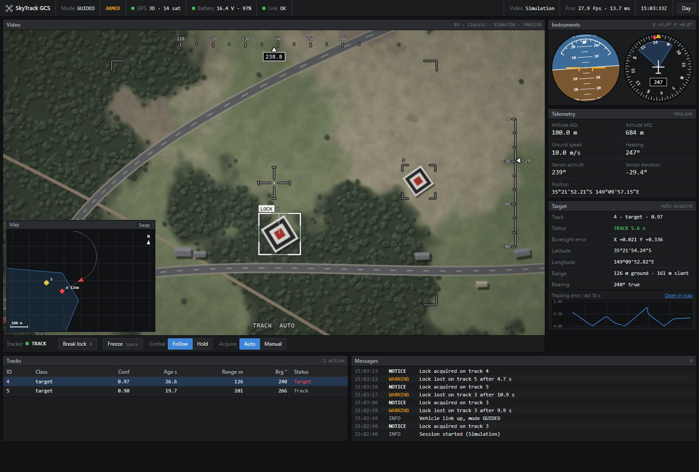

# SkyTrack — UAV Target Detection, Tracking & Target Lock

[](https://github.com/emir-mutlu/skytrack-uav-vision/actions/workflows/ci.yml)


Real-time perception pipeline for UAV video: **detect → track → lock**, with an operator HUD,
structured telemetry and a reproducible benchmark. Talks **MAVLink** to ArduPilot / PX4 flight
controllers to geolocate targets and keep the locked target centred with the camera gimbal.
An operator works it from a browser-based ground-control station. Runs on a laptop CPU, scales
to a GPU or an edge device (Jetson / ONNX / TensorRT) by swapping the detector.

<p align="center">
  
</p>

## Features

- **Pluggable detectors** — a lightweight OpenCV shape detector (CLAHE, auto-Canny, rotation-invariant
  shape test on the minimum-area rectangle, containment NMS, confidence score; no GPU or training
  data needed) **or** Ultralytics **YOLO11**
  (COCO / VisDrone / custom drone weights, ONNX / TensorRT export)
- **Kalman-filter multi-object tracker** — SORT family, Hungarian / greedy IoU association,
  persistent IDs, velocity estimates, coasting through short dropouts
- **Target-lock state machine** — `SEARCHING → ACQUIRING → LOCKED → LOST` with lock zone,
  minimum target size, hold time and grace period
- **Human-in-the-loop** — the operator designates a track (click / TAB); by default the system
  only proposes candidates
- **Flight-controller integration (MAVLink)** — ArduPilot / PX4 over TCP, UDP or serial: live
  position, attitude and gimbal telemetry, plus closed-loop **gimbal follow** (PID on angular
  error, `MAV_CMD_DO_GIMBAL_MANAGER_PITCHYAW` rate commands)
- **Target geolocation** — every track projected to latitude / longitude from the camera model,
  gimbal and vehicle attitude, and altitude; **terrain-aware** with SRTM / NASADEM `.hgt` tiles
  (ray marching + bisection, NumPy only), flat-ground fallback where the DEM has no data
- **Tested against real ArduPilot** — CI boots the official ArduCopter SITL firmware and checks
  telemetry, gimbal rate control, the link diagnostics and the operator console end to end
- **Hardware bring-up tool** — `skytrack link-check` verifies heartbeat, stream rates, GPS,
  gimbal reporting and gimbal motion with PASS / WARN / FAIL hints before the first flight
- **Ground-control console** — a browser GCS in the layout of desktop ground-control software:
  status toolbar (mode, arming, GPS, battery, link), payload video with click-to-designate and a
  picture-in-picture map, attitude and heading instruments, telemetry, target data, track grid and
  message log; standard library only (MJPEG + Server-Sent Events + a JSON command API)
- **Hardware-free testing** — built-in MAVLink vehicle simulator and a pan/tilt synthetic camera
  that closes the loop detector → lock → gimbal command → camera motion
- **Operator HUD** — translucent panels with crisp TrueType text, lock-zone brackets, boresight
  reticle, circular acquisition progress, pulsing lock box, fading trails, motion vectors and a
  boresight-error indicator; resolution-independent layout from 480p to 4K, ~5–7 ms per 720p frame
  thanks to cached glyph sprites
- **JSONL telemetry** — per-frame tracks and lock state, lock events, run summary
- **Any video source** — files, webcams, **RTSP / UDP streams** (threaded latest-frame grabber,
  no latency build-up)
- **Reproducible benchmark** — procedural aerial scene (forest, roads with traffic, buildings,
  rotating target boards, a drifting cloud) with ground truth: precision / recall / F1 / MOTA /
  ID switches / latency; **57 pytest tests**, accuracy regression gate in CI
- **Engineering** — installable package, YAML mission profiles, CLI, Docker image, GitHub Actions
  CI, ruff lint

## Architecture


```
src/skytrack/
├── detectors/        classic.py (OpenCV)  ·  yolo.py (Ultralytics)  ·  base.py
├── tracking.py       Kalman filter + data association
├── lock.py           lock-zone rules, state machine, operator API
├── pipeline.py       orchestration, keyboard/mouse control, video writer
├── hud.py            overlay rendering
├── telemetry.py      JSONL + summary
├── vehicle.py        MAVLink link: telemetry reader, gimbal commands
├── gimbal.py         gimbal-follow PID controller
├── geo.py            pixel -> lat/lon geolocation
├── terrain.py        flat / SRTM .hgt terrain, ray-terrain intersection
├── linkcheck.py      flight-controller bring-up diagnostics
├── simvehicle.py     minimal MAVLink vehicle for tests and demos
├── console/          web operator console: server.py (HTTP, MJPEG, SSE, commands),
│                     session.py (pipeline thread), static/ (UI)
├── sources.py        file / camera / threaded stream capture
├── synthetic.py      procedural aerial scene with ground truth + pan/tilt camera
├── evaluate.py       detection + CLEAR-MOT metrics
└── cli.py            `skytrack run | demo | console | eval | synth | sim-vehicle | link-check`
```

## Quick start

```bash
python -m venv .venv
.venv\Scripts\activate            # Linux/macOS: source .venv/bin/activate
pip install -e ".[dev]"           # core: OpenCV + NumPy only
pip install -e ".[yolo]"          # optional: deep-learning detector
pip install -e ".[mavlink]"       # optional: flight-controller link (included in [dev])
```

```bash
skytrack demo                                     # synthetic scene, interactive HUD
skytrack demo --closed-loop                       # + simulated MAVLink vehicle and gimbal follow
skytrack console                                  # browser ground-control console (simulation)
skytrack eval --config configs/demo.yaml          # benchmark against ground truth
skytrack run -s flight.mp4 -c configs/recon.yaml --save runs/out.mp4
skytrack run -s rtsp://192.168.1.10:8554/cam -c configs/counter_uas.yaml
skytrack run -s 0 --detector yolo --model yolo11n.pt   # webcam
```

**Controls:** left-click a box or `TAB` to designate a target · `R` release · `SPACE` pause · `Q` quit.
`--auto-lock` lets the system pick the candidate itself (useful for camera-follow tests).

## Operator console



`skytrack console` starts the pipeline and opens a ground-control console in the browser. With the
default `sim` source it flies the simulated MAVLink vehicle, so every panel is live without
hardware; point it at a real camera and autopilot the same way as `skytrack run`:

```bash
skytrack console                                                    # simulation, opens the browser
skytrack console -s rtsp://192.168.1.10:8554/cam -c configs/recon.yaml --mavlink udpin:0.0.0.0:14550
```

| Area | What it shows |
|---|---|
| Toolbar | Flight mode, arming state, GPS fix and satellites, battery voltage and charge, link status, processing rate, UTC |
| Video | Payload video with tracker symbology; click a target to designate it. A picture-in-picture map (north up, metric grid, sensor footprint, track symbols, vehicle track) swaps with the video (`M`) |
| Payload bar | Tracker mode (SEARCH / ACQUIRE / TRACK / COAST), break lock (`R`), freeze (`Space`), gimbal Follow / Hold (`F`), acquisition Auto / Manual (`A`) |
| Instruments | Attitude indicator; heading indicator with the sensor field of view and the bearing to the target |
| Telemetry | Altitude AGL / MSL, ground speed, heading, sensor azimuth and elevation, position |
| Target | Track, tracker status, boresight error, latitude / longitude, ground and slant range, bearing, tracking-error strip chart |
| Tracks / Messages | Every confirmed track with confidence, age, range and bearing (click to designate); lock, designation and link messages with severity |

The console is a single page served by the Python standard library: video over MJPEG, state over
Server-Sent Events at 10 Hz, commands as JSON (`POST /api/command`), and `/api/state`,
`/api/history` and `/api/snapshot.jpg` for tools and tests. `?poll` switches to plain polling for
networks that block streaming, and `?theme=day` opens the daylight display.

It listens on `127.0.0.1` by default. Commands are only accepted as `application/json` with a
matching origin, so another web page open in the operator's browser cannot designate targets or
move the gimbal; `--host 0.0.0.0` exposes it to the network and prints a warning.

## Operator HUD


Monochrome symbology in the style of EO/IR gimbal payload video:

| Element | Meaning |
|---|---|
| Centre reticle | Boresight; the gimbal-follow loop keeps the designated target on it |
| Track gate | Corner brackets on the designated target; `ACQ nn%` while acquiring, a `LOCK` tag once the lock is declared, dashed `LOST` while coasting. Other tracks get small grey brackets and their ID (`?` marks the lock candidate) |
| Top tape / right scale | Sensor azimuth (vehicle heading + gimbal yaw) and gimbal elevation, from MAVLink |
| Corner blocks | Sensor and profile, flight mode and arming, altitude and speed (top left); UTC, frame and processing rate (top right); aircraft position and gimbal angles (bottom left); target ID, lock time, position, slant and ground range (bottom right) |
| Bottom line | Tracker mode `SEARCH` / `ACQUIRE` / `TRACK` / `COAST`, `AUTO` or `MAN` acquisition, `FREEZE` when paused |

## Flight-controller integration (MAVLink)


SkyTrack runs as an **onboard-computer component** next to the autopilot (or on the ground
station). It reads the vehicle state and, with `--gimbal-follow`, steers the camera gimbal so the
designated target stays centred. Every track is geolocated, so a detection becomes a map
coordinate in the telemetry log and on the HUD.

| Direction | MAVLink messages |
|---|---|
| Autopilot → SkyTrack | `HEARTBEAT` (mode, armed), `GLOBAL_POSITION_INT`, `ATTITUDE`, `GIMBAL_DEVICE_ATTITUDE_STATUS` (gimbal v2) or `MOUNT_STATUS` (legacy) |
| SkyTrack → Autopilot | `HEARTBEAT`, `MAV_CMD_SET_MESSAGE_INTERVAL` (stream rates), `MAV_CMD_DO_GIMBAL_MANAGER_PITCHYAW` (gimbal pitch/yaw **rates**) |

**Without hardware, in one command.** A simulated vehicle flies a circle at 100 m and exposes a
gimbal over real MAVLink/TCP; the synthetic camera pans with that gimbal, so the whole loop runs:

```bash
skytrack demo --closed-loop
```

Or run the simulated vehicle separately and connect to it like a real autopilot:

```bash
skytrack sim-vehicle                                         # terminal 1: tcp 127.0.0.1:5760
skytrack demo --mavlink tcp:127.0.0.1:5760                   # terminal 2: telemetry + geolocation
```

UDP works the same way, including both ends on one Windows PC (`skytrack sim-vehicle --connection
udpout:127.0.0.1:14550` with `--mavlink udpin:0.0.0.0:14550`).

**ArduPilot SITL.** SITL serves MAVLink on TCP 5760, the same address:

```bash
sim_vehicle.py -v ArduCopter --console --map                 # in an ArduPilot checkout
skytrack run -s <camera stream> --mavlink tcp:127.0.0.1:5760 --gimbal-follow
```

Gimbal commands need a mount configured on the autopilot (`MNT1_TYPE`); see the ArduPilot
camera-gimbal documentation. The CI job `ArduPilot SITL integration` does exactly this with the
official ArduCopter stable SITL build and a servo gimbal (`tests/test_sitl.py`); run it locally
on Linux with `SKYTRACK_SITL_BIN=./arducopter pytest tests/test_sitl.py -s`.

**Real vehicle.**

| Link | Connection string |
|---|---|
| Pixhawk over USB | `--mavlink COM5` (Windows) · `--mavlink /dev/ttyACM0` (Linux) |
| Companion-computer UART (Jetson / Raspberry Pi) | `--mavlink /dev/ttyTHS1` with `mavlink.baud: 921600` in the profile |
| Telemetry radio / MAVProxy / mavlink-router output | `--mavlink udpin:0.0.0.0:14550` |

**First session on new hardware.** Before flying, run the bring-up check (props off for the
gimbal test):

```bash
skytrack link-check --mavlink COM5 --gimbal-test
```

```
SkyTrack link check -> COM5
  [PASS] heartbeat: mode GUIDED, ARMED, system 1
  [PASS] GLOBAL_POSITION_INT             16.0 Hz
  [PASS] ATTITUDE                        16.0 Hz
  [INFO] GIMBAL_DEVICE_ATTITUDE_STATUS   16.0 Hz
  [PASS] position -35.3619422, 149.1655695  alt 100.0 m rel / 684.0 m AMSL
  [PASS] gimbal attitude (gimbal_v2): pitch -45.0, yaw +0.0
  [PASS] DO_GIMBAL_MANAGER_PITCHYAW accepted
  [PASS] gimbal yaw moved 22.5 deg on a 15 deg/s x 1.5 s command
RESULT: PASS
```

Every FAIL / WARN line says what to fix (serial protocol, baud, GPS fix, `MNT1_TYPE`, firmware
version); the command exits non-zero on failure, so it can gate a pre-flight script.

### Terrain-aware geolocation

Set the lens field of view with `--hfov` (or `camera.hfov_deg`); geolocation accuracy depends on
it. By default the ground is a plane at the home altitude, accurate to a few metres below ~2 km
over level ground. Over hills, slopes or valleys, point SkyTrack at SRTM / NASADEM tiles
(`N41E028.hgt`, 1" or 3" grids from USGS EarthExplorer or OpenTopography):

```yaml
terrain:
  source: hgt
  path: data/dem          # directory of *.hgt tiles
```

The camera ray is marched across the DEM (bilinear elevation lookup) and the first ground
crossing is refined by bisection, so a target on a slope facing the camera lands where the line
of sight actually meets the ground, and a ridge blocks what lies behind it. Cells without data
fall back to the flat model; the HUD and telemetry state which model (`DEM` / `FLAT`) each
coordinate came from.

## Mission profiles (`configs/`)

| Profile | Use case | Detector | Lock behaviour |
|---|---|---|---|
| `demo.yaml` | Synthetic markers, no GPU | classic | auto candidate, 1 s hold |
| `recon.yaml` | ISR / surveillance (people, vehicles) | YOLO11n, COCO classes | operator designates, 0.5 s hold |
| `sar.yaml` | Search & rescue (people, high recall) | YOLO11s @1280 px | lock disabled, long track memory |
| `counter_uas.yaml` | Air-to-air drone tracking (competition-style camera lock) | custom `drone` weights | target fully inside central zone, ≥5 % of frame, 4 s hold, operator confirm |

Train custom weights (e.g. VisDrone or a drone dataset in YOLO format) and export for the edge:

```bash
python scripts/train.py --data VisDrone.yaml --model yolo11n.pt --imgsz 960 --epochs 100 --export onnx engine
```

## Benchmark (synthetic, 600 frames, 1200 GT objects, CPU)

Classic detector + Kalman tracker on the built-in procedural aerial scene: forest canopy, roads,
buildings and cars driving as distractors, two rotating target boards, camera shake, optics blur,
sensor noise, and a cloud that drifts through the view every 12 s to hide targets on purpose:

| Metric | Value |
|---|---|
| Detection precision / recall / F1 | 0.979 / 0.968 / **0.974** |
| Tracking MOTA | **0.933** |
| ID switches | 1 |
| Latency (mean / p95) | **5.6 ms / 6.6 ms** per 960×540 frame |

Reproduce with `skytrack eval --config configs/demo.yaml --frames 600`. The misses come from the
cloud passes; the cloud-free first 300 frames score F1 1.00. The shape test runs on the
minimum-area rotated rectangle, so the boards are found at any rotation while cars (elongated)
and tree crowns (round) are rejected at any heading.

## Telemetry

Each frame is one JSON line, ready for pandas, Grafana or a ground-station bridge:

```json
{"frame": 92, "t": 3.0667, "fps": 22.4, "latency_ms": 6.1,
 "tracks": [{"id": 3, "label": "target", "score": 0.98, "bbox": [431.2, 117.9, 476.1, 162.4], "vel": [-2.1, 0.9]}],
 "lock": {"state": "LOCKED", "track_id": 3, "candidate_id": 3, "progress": 1.0, "error": [-0.06, -0.49]},
 "events": []}
```

`lock.error` is the target's offset from image centre in `[-1, 1]`, the input of the gimbal-follow
controller. With a MAVLink link each record also carries `vehicle` (position, attitude, gimbal),
per-track `geo` coordinates, `target_geo` and the `gimbal_cmd_dps` that were sent.

## Scope & responsible use

SkyTrack is a **perception and decision-support** system. It detects, tracks, geolocates and
reports. Its only actuation is **pointing the camera gimbal**: it never commands vehicle motion,
flight modes or arming, and it contains **no weapon-release or engagement logic**. The default
profiles keep a human operator in the loop for target designation. Integrators are responsible for complying with
applicable law, airspace rules and rules of engagement.

## Development

```bash
pytest -q          # 57 tests incl. console API, HUD, live MAVLink, DEM, closed-loop gimbal follow
ruff check src tests scripts
python scripts/render_media.py   # regenerate README media (assets/*.png, assets/demo.webp)
docker build -t skytrack . && docker run --rm -v %cd%/runs:/app/runs skytrack
docker run --rm -p 8080:8080 skytrack console --host 0.0.0.0 --no-browser   # console in Docker
```

## Roadmap

- Camera-motion compensation (ECC / optical flow) before association, for fast-turning platforms
- Appearance re-ID embeddings (DeepSORT / BoT-SORT) for long occlusions
- Gazebo + ArduPilot SITL camera for photorealistic closed-loop testing
- Multi-target geolocation fusion over time (track-level position filter) for metre-level fixes
- Thermal (IR) model for night operation
- Small-object tiling (SAHI) for high-altitude imagery

## License

MIT
