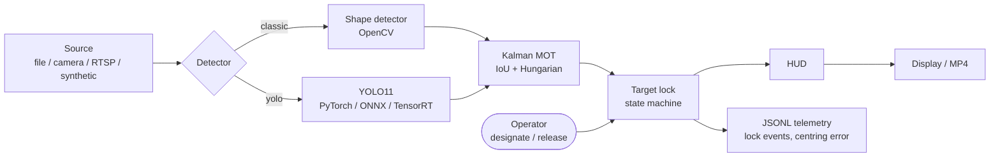

# SkyTrack — UAV Target Detection, Tracking & Target Lock

Real-time perception pipeline for UAV video: **detect → track → lock**, with an operator HUD,
structured telemetry and a reproducible benchmark. Runs on a laptop CPU, scales to a GPU or an
edge device (Jetson / ONNX / TensorRT) by swapping the detector.

<p align="center">
  
</p>

## Features

- **Pluggable detectors** — a lightweight OpenCV shape detector (CLAHE, auto-Canny, containment
  NMS, confidence score; no GPU or training data needed) **or** Ultralytics **YOLO11**
  (COCO / VisDrone / custom drone weights, ONNX / TensorRT export)
- **Kalman-filter multi-object tracker** — SORT family, Hungarian / greedy IoU association,
  persistent IDs, velocity estimates, coasting through short dropouts
- **Target-lock state machine** — `SEARCHING → ACQUIRING → LOCKED → LOST` with lock zone,
  minimum target size, hold time and grace period
- **Human-in-the-loop** — the operator designates a track (click / TAB); by default the system
  only proposes candidates
- **Centring error output** — normalised target offset for gimbal / camera follow
- **Operator HUD** — translucent panels with crisp TrueType text, lock-zone brackets, boresight
  reticle, circular acquisition progress, pulsing lock box, fading trails, motion vectors and a
  boresight-error indicator; resolution-independent layout from 480p to 4K, ~5–7 ms per 720p frame
  thanks to cached glyph sprites
- **JSONL telemetry** — per-frame tracks and lock state, lock events, run summary
- **Any video source** — files, webcams, **RTSP / UDP streams** (threaded latest-frame grabber,
  no latency build-up)
- **Reproducible benchmark** — synthetic scene with ground truth (precision / recall / F1 / MOTA /
  ID switches / latency), **28 pytest tests**, accuracy regression gate in CI
- **Engineering** — installable package, YAML mission profiles, CLI, Docker image, GitHub Actions
  CI, ruff lint

## Architecture



```
src/skytrack/
├── detectors/        classic.py (OpenCV)  ·  yolo.py (Ultralytics)  ·  base.py
├── tracking.py       Kalman filter + data association
├── lock.py           lock-zone rules, state machine, operator API
├── pipeline.py       orchestration, keyboard/mouse control, video writer
├── hud.py            overlay rendering
├── telemetry.py      JSONL + summary
├── sources.py        file / camera / threaded stream capture
├── synthetic.py      ground-truth scene generator
├── evaluate.py       detection + CLEAR-MOT metrics
└── cli.py            `skytrack run | demo | eval | synth`
```

## Quick start

```bash
python -m venv .venv
.venv\Scripts\activate            # Linux/macOS: source .venv/bin/activate
pip install -e ".[dev]"           # core: OpenCV + NumPy only
pip install -e ".[yolo]"          # optional: deep-learning detector
```

```bash
skytrack demo                                     # synthetic scene, interactive HUD
skytrack eval --config configs/demo.yaml          # benchmark against ground truth
skytrack run -s flight.mp4 -c configs/recon.yaml --save runs/out.mp4
skytrack run -s rtsp://192.168.1.10:8554/cam -c configs/counter_uas.yaml
skytrack run -s 0 --detector yolo --model yolo11n.pt   # webcam
```

**Controls:** left-click a box or `TAB` to designate a target · `R` release · `SPACE` pause · `Q` quit.
`--auto-lock` lets the system pick the candidate itself (useful for camera-follow tests).

## Operator HUD


| Element | Meaning |
|---|---|
| Status pill (top left) | Lock state — `SEARCHING` · `ACQUIRING` · `LOCKED` · `LOST` — with target ID and lock time |
| Telemetry (top right) | Processing FPS, detector latency, active tracks, detector backend |
| Corner brackets | Tracks: teal = tracked, cyan = lock candidate, amber/red = designated target |
| Amber ring / red box | Acquisition progress / confirmed lock |
| Dashed line + error box | Target offset from the boresight, the signal a gimbal controller would centre |

## Mission profiles (`configs/`)

| Profile | Use case | Detector | Lock behaviour |
|---|---|---|---|
| `demo.yaml` | Synthetic markers, no GPU | classic | auto candidate, 1 s hold |
| `recon.yaml` | ISR / surveillance (people, vehicles) | YOLO11n, COCO classes | operator designates, 0.5 s hold |
| `sar.yaml` | Search & rescue (people, high recall) | YOLO11s @1280 px | lock disabled, long track memory |
| `counter_uas.yaml` | Air-to-air drone tracking (competition-style camera lock) | custom `drone` weights | target fully inside central zone, ≥5 % of frame, 4 s hold, operator confirm |

Train custom weights (e.g. VisDrone or a drone dataset in YOLO format) and export for the edge:

```bash
python scripts/train.py --data VisDrone.yaml --model yolo11n.pt --imgsz 960 --epochs 100 --export onnx engine
```

## Benchmark (synthetic, 600 frames, 1200 GT objects, CPU)

Classic detector + Kalman tracker on the built-in scene (camera jitter, sensor noise, distractor
shapes, and a periodic haze band that deliberately hides targets):

| Metric | Value |
|---|---|
| Detection precision / recall / F1 | 0.905 / 0.889 / **0.897** |
| Tracking MOTA | **0.80** |
| ID switches | 1 |
| Latency (mean / p95) | **6.2 ms / 7.9 ms** per 960×540 frame |

Reproduce with `skytrack eval --config configs/demo.yaml --frames 600`. Most misses come from the
haze band; without it F1 is ≈0.95 (first 300 frames).

## Telemetry

Each frame is one JSON line, ready for pandas, Grafana or a ground-station bridge:

```json
{"frame": 92, "t": 3.0667, "fps": 22.4, "latency_ms": 6.1,
 "tracks": [{"id": 3, "label": "target", "score": 0.98, "bbox": [431.2, 117.9, 476.1, 162.4], "vel": [-2.1, 0.9]}],
 "lock": {"state": "LOCKED", "track_id": 3, "candidate_id": 3, "progress": 1.0, "error": [-0.06, -0.49]},
 "events": []}
```

`lock.error` is the target's offset from image centre in `[-1, 1]` — the input a gimbal/camera
controller needs to keep the target centred.

## Scope & responsible use

SkyTrack is a **perception and decision-support** system. It detects, tracks and reports; it
contains **no actuation, weapon-release or engagement logic**, and the default profiles keep a
human operator in the loop for target designation. Integrators are responsible for complying with
applicable law, airspace rules and rules of engagement.

## Development

```bash
pytest -q          # 28 tests incl. HUD rendering, end-to-end pipeline and accuracy regression gate
ruff check src tests scripts
python scripts/render_media.py   # regenerate README media (assets/hud.png, assets/demo.webp)
docker build -t skytrack . && docker run --rm -v %cd%/runs:/app/runs skytrack
```

## Roadmap

- Camera-motion compensation (ECC / optical flow) before association, for fast-turning platforms
- Appearance re-ID embeddings (DeepSORT / BoT-SORT) for long occlusions
- MAVLink bridge: publish `lock.error` as gimbal rate commands, ingest UAV attitude/GPS for geo-located tracks
- Thermal (IR) model for night operation
- Small-object tiling (SAHI) for high-altitude imagery

## License

MIT
